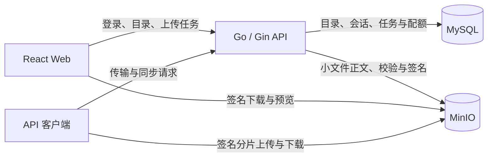

# CloudNest

CloudNest 是一套面向学习和个人文件管理的私有云盘。它提供可独立体验的 Web 演示、连接真实存储的 Web 文件管理界面，以及供客户端接入的传输与同步 API。

后端使用 Go、Gin 和 GORM，Web 使用 React、TypeScript、Vite 和 Ant Design。MySQL 保存目录、权限和任务状态，MinIO 保存文件正文。

[首版功能](#首版功能) · [快速开始](#快速开始) · [API 概览](#api-概览) · [仓库结构](#仓库结构)

## 首版功能

| 使用入口 | 可以使用的功能 |
| --- | --- |
| Web 演示 | 使用内置样例浏览和整理文件，体验搜索、收藏、预览、回收站以及模拟上传进度。页面状态保存在内存中，刷新会恢复样例。 |
| Web 文件管理 | 登录后浏览真实目录，新建文件夹、改名、移动和回收文件。支持 **16 MiB 以内**的单文件上传、任务状态查询与取消、签名下载，以及支持格式的图片和文本预览。 |
| Web 回收站 | 分页查看已回收的文件和目录，恢复条目并查看实际恢复位置。永久清理提供范围预检、二次确认和进度查询。 |
| 传输 API | 提供小文件上传和 S3 Multipart 分片上传。客户端可查询已上传分片、补传缺失部分，并在同一账号内复用已经验证的内容。大文件初始上限为 50 GiB，受服务配置和存储能力约束。 |
| 同步和历史 API | 支持分页快照、设备基线确认、增量变更拉取与确认。内容替换按预期修订号执行，被替换的正文通过历史版本引用继续保留。 |

首版交付 Web 手动文件管理和后端传输、同步协议。分片传输与同步通过 API 接入，桌面和移动客户端属于后续阶段。

## 文件怎么流转



- **小文件上传**。客户端先创建上传任务，再把正文发送给 Go API。服务端保存正文并核对大小和 SHA-256 摘要，校验通过后发布目录项、结算配额。
- **分片上传**。客户端按服务端给定的分片计划申请短期签名 URL，直接向 MinIO 上传分片。中断后查询已保存分片，再补传缺失内容。合并与整文件校验通过后才发布。
- **同步与冲突**。设备从一致性快照建立基线，随后拉取并确认增量位置。带预期修订号的内容替换会检查当前文件版本，旧修订号无法覆盖已提交的新内容。

## 快速开始

以下命令在仓库根目录使用 PowerShell 执行。前端使用 Node.js 24 和 pnpm 11.21.0。运行完整环境另需 Go 1.27.2、Python 3.11 或更新版本，以及已启动的 Docker 和 Docker Compose。

### 只体验 Web 演示

```powershell
pnpm --dir apps/web install --frozen-lockfile
$env:VITE_CLOUDNEST_DATA_MODE = 'demo'
pnpm --dir apps/web dev
```

打开 [http://127.0.0.1:5173](http://127.0.0.1:5173) 即可操作样例文件。

### 启动真实文件管理

**1. 启动基础设施并准备存储桶**

```powershell
./scripts/Start-Infra.ps1
python scripts/verify_infra.py --service minio
```

启动脚本从 [示例配置](scripts/.env.example) 生成本地 `scripts/.env`，并启动 MySQL、MinIO 和 Redis。首次运行需要下载依赖并构建固定版本的 MinIO。验证脚本会准备 `cloudnest` 私有桶并检查存储读写。

**2. 应用数据库迁移并启动 API**

```powershell
$env:CLOUDNEST_ADMIN_PASSWORD = '<替换为你的本地登录密码>'
go run ./cmd/database -database cloudnest -seed
go run ./cmd/server
```

`-seed` 首次创建业务账号 `root` 和根目录。已有业务账号沿用原密码。API 默认监听 `127.0.0.1:18081`，可在另一个终端检查就绪状态。

```powershell
Invoke-RestMethod http://127.0.0.1:18081/health/ready
```

**3. 启动 Web 并登录**

另开一个 PowerShell，回到仓库根目录。

```powershell
pnpm --dir apps/web install --frozen-lockfile
$env:VITE_CLOUDNEST_DATA_MODE = 'api'
pnpm --dir apps/web dev
```

打开 [http://127.0.0.1:5173](http://127.0.0.1:5173)，使用业务账号 `root` 和初始化时设置的密码登录。Web 开发服务器会将 `/api` 请求转发到本地 API。

### 常用本地配置

| 配置项 | 本地值或用途 |
| --- | --- |
| `CLOUDNEST_HTTP_ADDR` | API 监听地址，默认 `127.0.0.1:18081`。 |
| `CLOUDNEST_WEB_API_TARGET` | Vite 在 API 模式下的代理目标，默认 `http://127.0.0.1:18081`。修改 API 地址后同步调整。 |
| `CLOUDNEST_ALLOWED_ORIGINS` | 允许访问 API 的 Web 来源，默认 `http://127.0.0.1:5173`。 |
| `CLOUDNEST_DB_ADDRESS`、`CLOUDNEST_DB_USER`、`CLOUDNEST_DB_PASSWORD` | Go 进程的 MySQL 连接配置，默认地址为 `127.0.0.1:13309`。修改 Compose 端口或数据库凭据后同步调整。 |
| `CLOUDNEST_S3_ENDPOINT`、`CLOUDNEST_S3_PUBLIC_ENDPOINT` | Go 访问 MinIO 的地址和客户端访问签名 URL 的地址。默认使用 `127.0.0.1:19000`。 |
| `CLOUDNEST_S3_ACCESS_KEY`、`CLOUDNEST_S3_SECRET_KEY` | Go 访问 MinIO 的凭据，需与本地存储配置匹配。 |

示例配置用于回环地址上的开发环境。Compose 从本地配置文件读取基础设施设置，`go run` 从当前终端环境读取应用设置。

## API 概览

完整的请求字段、认证要求、响应和错误码见 [OpenAPI](api/openapi.yaml)。常用入口如下。

| 用途 | 代表端点 |
| --- | --- |
| 账号与会话 | `POST /api/v1/auth/login` · `POST /api/v1/auth/refresh` · `GET /api/v1/me` |
| 文件与目录 | `GET /api/v1/entries` · `POST /api/v1/directories` · `POST /api/v1/entries/{id}/download` |
| 上传与续传 | `POST /api/v1/uploads` · `POST /api/v1/uploads/{id}/part-urls` · `GET /api/v1/uploads/{id}/parts` |
| 回收与恢复 | `GET /api/v1/trash` · `POST /api/v1/trash/{id}/restore` · `GET /api/v1/trash/{id}/purge-preview` |
| 替换与同步 | `POST /api/v1/entries/{id}/content-replacement` · `POST /api/v1/sync/snapshots` · `POST /api/v1/sync/changes/pull` |
| 健康检查 | `GET /health/live` · `GET /health/ready` |

## 仓库结构

| 路径 | 职责 |
| --- | --- |
| [apps/web](apps/web) | Web 演示及 API 模式界面。 |
| [cmd/server](cmd/server) | API 入口、依赖装配和后台任务。 |
| [internal/server](internal/server) | HTTP、业务逻辑、数据库访问与对象存储适配。 |
| [cmd/database](cmd/database) · [migrations](migrations) | 数据库初始化、业务账号初始化和版本化 SQL 迁移。 |
| [cmd/restore-sync](cmd/restore-sync) | 备份恢复后，在目标服务停服期间检查并重置同步代次。 |
| [scripts](scripts) | 本地基础设施的启动和验证脚本。 |

## 构建

```powershell
go build ./cmd/...
pnpm --dir apps/web install --frozen-lockfile
pnpm --dir apps/web build
```

Web 构建产物位于 `apps/web/dist`。构建真实 API 模式前设置 `VITE_CLOUDNEST_DATA_MODE=api`，部署时为 `/api` 配置同源代理。离线同步恢复工具的参数可通过 `go run ./cmd/restore-sync --help` 查看。
