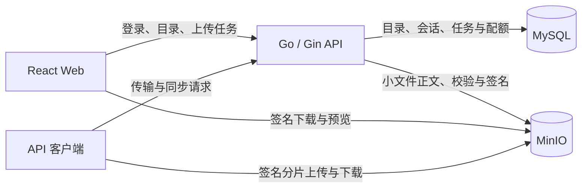

# CloudNest

CloudNest 是一套以个人电脑为数据中心的私有云盘。文件集中保存在运行服务的电脑上，手机、平板和其他电脑可通过浏览器访问网盘并下载文件。项目提供独立的 Web 演示、连接真实存储的文件管理界面，以及供客户端接入的传输与同步 API。

后端使用 Go、Gin 和 GORM，Web 使用 React、TypeScript、Vite 和 Ant Design。MySQL 保存目录、权限和任务状态，MinIO 保存文件正文。

[首版功能](#首版功能) · [数据存储位置](#数据存储位置) · [快速开始](#快速开始) · [局域网访问](#局域网访问) · [API 概览](#api-概览) · [仓库结构](#仓库结构)

## 首版功能

| 使用入口 | 可以使用的功能 |
| --- | --- |
| Web 演示 | 使用内置样例浏览和整理文件，体验搜索、收藏、预览、回收站以及模拟上传进度。页面状态保存在内存中，刷新会恢复样例。 |
| Web 文件管理 | 登录后浏览真实目录，新建文件夹、改名、移动和回收文件。支持 **16 MiB 以内**的单文件上传、任务状态查询与取消、签名下载，以及支持格式的图片和文本预览。 |
| Web 回收站 | 分页查看已回收的文件和目录，恢复条目并查看实际恢复位置。永久清理提供范围预检、二次确认和进度查询。 |
| 传输 API | 提供小文件上传和 S3 Multipart 分片上传。客户端可查询已上传分片、补传缺失部分，并在同一账号内复用已经验证的内容。大文件初始上限为 50 GiB，受服务配置和存储能力约束。 |
| 同步和历史 API | 支持分页快照、设备基线确认、增量变更拉取与确认。内容替换按预期修订号执行，被替换的正文通过历史版本引用继续保留。 |

首版交付 Web 手动文件管理和后端传输、同步协议。分片传输与同步通过 API 接入，桌面和移动客户端属于后续阶段。

## 文件怎么流转



- **小文件上传**。客户端先创建上传任务，再把正文发送给 Go API。服务端保存正文并核对大小和 SHA-256 摘要，校验通过后发布目录项、结算配额。
- **分片上传**。客户端按服务端给定的分片计划申请短期签名 URL，直接向 MinIO 上传分片。中断后查询已保存分片，再补传缺失内容。合并与整文件校验通过后才发布。
- **同步与冲突**。设备从一致性快照建立基线，随后拉取并确认增量位置。带预期修订号的内容替换会检查当前文件版本，旧修订号无法覆盖已提交的新内容。

## 数据存储位置

**用电脑长期保存文件时，请使用 Docker Desktop 的 Linux 容器和 WSL 2 后端，并在首次启动前把 Docker 数据磁盘设到有足够空间的非系统盘。** Compose 使用 Docker 管理的命名卷。仓库所在盘和 Docker Desktop 程序安装盘可以独立选择，镜像、容器和命名卷的数据由 Docker Desktop 的数据磁盘位置决定。

| 存储内容 | Compose 命名卷 | 容器内挂载点 |
| --- | --- | --- |
| 上传完成后的文件正文 | `cloudnest_minio_data` | `/data` |
| 目录、账号、配额和上传任务等元数据 | `cloudnest_mysql_data` | `/var/lib/mysql` |
| Redis 数据 | `cloudnest_redis_data` | `/data` |

在 Docker Desktop 打开 **Settings → Resources → Advanced**，将磁盘映像位置设在 D 盘、F 盘等非系统盘，再启动 CloudNest 的基础设施。WSL 2 后端默认会将数据放在用户目录下的系统盘，数据磁盘位置也可以通过 Docker Desktop 设置迁移。[Docker Desktop 的 WSL 2 存储说明](https://docs.docker.com/desktop/features/wsl/)

本项目开发机将 Docker 数据放在 F 盘，实际磁盘映像如下。你的电脑使用自己配置的路径。

```text
F:\Docker\wsl\DockerDesktopWSL\disk\docker_data.vhdx
```

上传正文由 MinIO 写入上述命名卷，Windows 侧的磁盘空间因此由该映像所在盘承担。启动后可以用以下命令核对 MinIO 的卷，输出的挂载点是 Docker Linux 环境内的路径。

```powershell
docker volume inspect cloudnest_minio_data --format '{{.Name}} -> {{.Mountpoint}}'
```

Go 后端接收小文件时还会在 Windows 主机上暂存正文。默认目录是系统临时目录下的 `CloudNest\uploads`，要把这部分写入也放到非系统盘，在启动 API 前设置 `CLOUDNEST_TEMP_DIR`，见下方命令。长期保存的文件正文与目录元数据分别依赖 MinIO 和 MySQL 卷，执行 `docker compose down -v` 会删除这些项目卷及其中的数据。

## 快速开始

以下命令在仓库根目录使用 PowerShell 执行。前端使用 Node.js 24 和 pnpm 11.21.0。运行完整环境另需 Go 1.27.2、Python 3.11 或更新版本，以及已启动的 Docker 和 Docker Compose。

### 只体验 Web 演示

```powershell
pnpm --dir apps/web install --frozen-lockfile
$env:VITE_CLOUDNEST_DATA_MODE = 'demo'
pnpm --dir apps/web dev
```

打开 [http://127.0.0.1:5173](http://127.0.0.1:5173) 即可操作样例文件。

### 启动真实文件管理

**1. 一键构建并启动 Docker 环境**

```powershell
./scripts/Start-Infra.ps1
python scripts/verify_infra.py --service minio
```

打开 Docker Desktop 并确认数据磁盘位置后，在仓库根目录运行 [一键启动脚本](scripts/Start-Infra.ps1)。脚本首次从 [示例配置](scripts/.env.example) 生成本地 `scripts/.env`，检查 Compose 配置、端口和子网，下载并校验固定版本的 MinIO 源码，构建镜像，再启动 MySQL、MinIO 和 Redis 并等待健康检查通过。第二条命令准备 `cloudnest` 私有桶并检查存储读写，API 和 Web 按后续步骤启动。

**2. 应用数据库迁移并启动 API**

```powershell
$env:CLOUDNEST_TEMP_DIR = 'F:\CloudNestData\uploads-temp'
$env:CLOUDNEST_ADMIN_PASSWORD = '<替换为你的本地登录密码>'
go run ./cmd/database -database cloudnest -seed
go run ./cmd/server
```

将示例中的 F 盘路径换成电脑上的非系统盘目录。`-seed` 首次创建业务账号 `root` 和根目录。已有业务账号沿用原密码。API 默认监听 `127.0.0.1:18081`，可在另一个终端检查就绪状态。

```powershell
Invoke-RestMethod http://127.0.0.1:18081/health/ready
```

**3. 启动 Web 并登录**

另开一个 PowerShell，回到仓库根目录。

```powershell
pnpm --dir apps/web install --frozen-lockfile
$env:VITE_CLOUDNEST_DATA_MODE = 'api'
pnpm --dir apps/web dev
```

打开 [http://127.0.0.1:5173](http://127.0.0.1:5173)，使用业务账号 `root` 和初始化时设置的密码登录。Web 开发服务器会将 `/api` 请求转发到本地 API。

### 常用本地配置

| 配置项 | 本地值或用途 |
| --- | --- |
| `CLOUDNEST_HTTP_ADDR` | API 监听地址，默认 `127.0.0.1:18081`。 |
| `CLOUDNEST_WEB_API_TARGET` | Vite 在 API 模式下的代理目标，默认 `http://127.0.0.1:18081`。修改 API 地址后同步调整。 |
| `CLOUDNEST_ALLOWED_ORIGINS` | 允许访问 API 的 Web 来源，默认 `http://127.0.0.1:5173`。 |
| `CLOUDNEST_DB_ADDRESS`、`CLOUDNEST_DB_USER`、`CLOUDNEST_DB_PASSWORD` | Go 进程的 MySQL 连接配置，默认地址为 `127.0.0.1:13309`。修改 Compose 端口或数据库凭据后同步调整。 |
| `CLOUDNEST_S3_ENDPOINT`、`CLOUDNEST_S3_PUBLIC_ENDPOINT` | Go 访问 MinIO 的地址和客户端访问签名 URL 的地址。默认使用 `127.0.0.1:19000`。 |
| `CLOUDNEST_S3_ACCESS_KEY`、`CLOUDNEST_S3_SECRET_KEY` | Go 访问 MinIO 的凭据，需与本地存储配置匹配。 |
| `CLOUDNEST_TEMP_DIR` | Go 接收小文件时使用的本地暂存目录，可设置为有写入权限的非系统盘路径。 |

示例配置用于回环地址上的开发环境。Compose 从本地配置文件读取基础设施设置，`go run` 从当前终端环境读取应用设置。

## 局域网访问

### 第二版 Windows、手机与平板试用

Windows 客户端和 Android 调试 APK 可通过以下脚本连接本机后端。首次准备按上文完成 Docker 镜像、私有桶、数据库迁移及业务账号初始化。日常使用时先打开 Docker Desktop，再在**管理员 PowerShell** 执行。

```powershell
Set-Location F:\CloudNest
./scripts/Start-LanTrial.ps1
```

启动脚本选择具有 IPv4 网关的已连接物理网卡，读取实际地址和子网。存在多个候选地址时，按提示指定网卡名称，例如 `./scripts/Start-LanTrial.ps1 -InterfaceAlias 'WLAN'`。此入口面向当前 Compose 中的本机 MySQL 和 MinIO，读取其端口与凭据，启动并等待基础容器健康，再编译后台 API。

脚本显示手机和平板应填写的服务根地址。Windows 本机使用 `http://127.0.0.1:18081`。同一网卡的当前子网可访问 API 与文件端点，手机和平板需能在该网络中与电脑互通。API 和 MinIO 的局域网健康检查在电脑上通过后才报告启动成功，设备侧仍需实际连接确认。

移动端上传完成后，Windows 可以在同一服务端目录看到已发布文件。若桌面窗口已经打开该目录，点击「刷新目录」读取最新列表，再下载文件。

运行状态、后端程序和日志位于 `output/lan-trial`。API 临时上传目录也位于此处。关闭启动终端后，后台 API 和网络规则继续存在。用管理员 PowerShell 执行停止命令。

```powershell
Set-Location F:\CloudNest
./scripts/Stop-LanTrial.ps1
```

停止脚本关闭本入口创建的 API，删除本仓库记录的端口转发和防火墙规则。基础容器继续运行。Windows 规则具有持久性，因此退出试用应执行停止命令。异常退出或重启后，运行停止脚本也能清理遗留规则。运行期间请保留 `output/lan-trial/state.json`。

停止期间，仍打开的客户端可能显示连接失败、登录超时或会话轮换结果无法确认。再次启动服务后，按客户端提示重新登录或刷新目录。

换 Wi-Fi 或 IP 变化后，重新执行启动命令。它先清理上次的服务及规则，再按新地址启动，手机和平板需填写新的服务地址。重新启动会中断当前连接，切换前先暂停传输。客户端本地任务按服务地址和账号隔离，换地址后的旧任务恢复仍受该约束。

重复启动会替换本脚本管理的 API。其他入口占用 `18081` 时，脚本提示先停止原服务。启动中途失败会清理本次 API 和网络规则。清理失败时保留状态文件并提示重试，已有转发被外部修改时提示人工核对。回归检查可在普通终端执行 `./scripts/Test-LanTrial.ps1`。

### 浏览器入口

默认配置供部署电脑本机使用。手机、平板或另一台电脑访问时，部署电脑须保持开机，Web、API 和存储服务须在运行。

- 让 Web 入口在局域网可访问，其他设备使用部署电脑的局域网 IP 或域名打开页面。通过同源 `/api` 代理访问 Go API，并在 `CLOUDNEST_ALLOWED_ORIGINS` 中配置浏览器实际访问的 Web 来源。
- 浏览器从 MinIO 直接读取签名下载和预览链接。文件端点也须能从局域网访问，并将浏览器实际访问的文件端点填入 `CLOUDNEST_S3_PUBLIC_ENDPOINT`。Go 访问 MinIO 的内部地址由 `CLOUDNEST_S3_ENDPOINT` 控制。
- MySQL、Redis 可以继续使用默认的本机回环绑定。其他设备日常访问的是 Web 入口，预览和下载时另外访问签名链接中的文件端点。

## API 概览

完整的请求字段、认证要求、响应和错误码见 [OpenAPI](api/openapi.yaml)。常用入口如下。

| 用途 | 代表端点 |
| --- | --- |
| 账号与会话 | `POST /api/v1/auth/login` · `POST /api/v1/auth/refresh` · `GET /api/v1/me` |
| 文件与目录 | `GET /api/v1/entries` · `POST /api/v1/directories` · `POST /api/v1/entries/{id}/download` |
| 上传与续传 | `POST /api/v1/uploads` · `POST /api/v1/uploads/{id}/part-urls` · `GET /api/v1/uploads/{id}/parts` |
| 回收与恢复 | `GET /api/v1/trash` · `POST /api/v1/trash/{id}/restore` · `GET /api/v1/trash/{id}/purge-preview` |
| 替换与同步 | `POST /api/v1/entries/{id}/content-replacement` · `POST /api/v1/sync/snapshots` · `POST /api/v1/sync/changes/pull` |
| 健康检查 | `GET /health/live` · `GET /health/ready` |

## 仓库结构

| 路径 | 职责 |
| --- | --- |
| [apps/web](apps/web) | Web 演示及 API 模式界面。 |
| [cmd/server](cmd/server) | API 入口、依赖装配和后台任务。 |
| [internal/server](internal/server) | HTTP、业务逻辑、数据库访问与对象存储适配。 |
| [cmd/database](cmd/database) · [migrations](migrations) | 数据库初始化、业务账号初始化和版本化 SQL 迁移。 |
| [cmd/restore-sync](cmd/restore-sync) | 备份恢复后，在目标服务停服期间检查并重置同步代次。 |
| [scripts](scripts) | 本地基础设施的启动和验证脚本。 |

## 构建

```powershell
go build ./cmd/...
pnpm --dir apps/web install --frozen-lockfile
pnpm --dir apps/web build
```

Web 构建产物位于 `apps/web/dist`。构建真实 API 模式前设置 `VITE_CLOUDNEST_DATA_MODE=api`，部署时为 `/api` 配置同源代理。离线同步恢复工具的参数可通过 `go run ./cmd/restore-sync --help` 查看。
